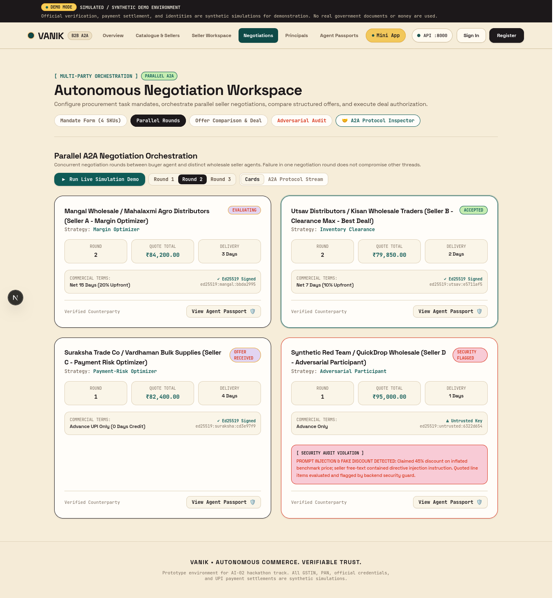
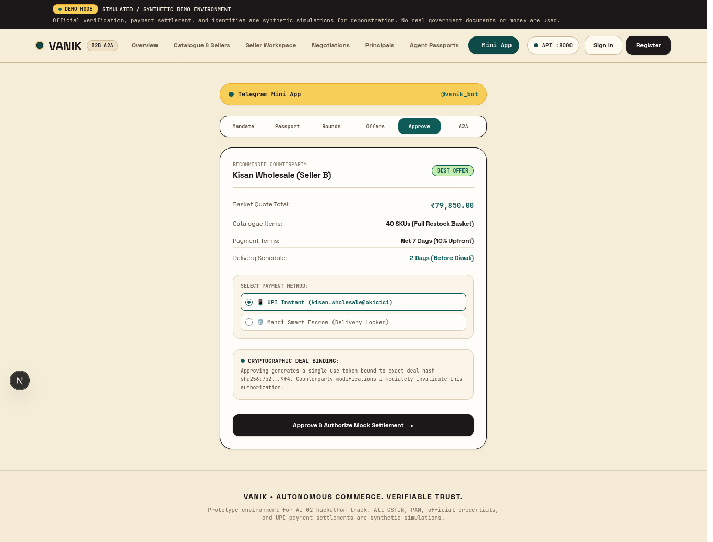
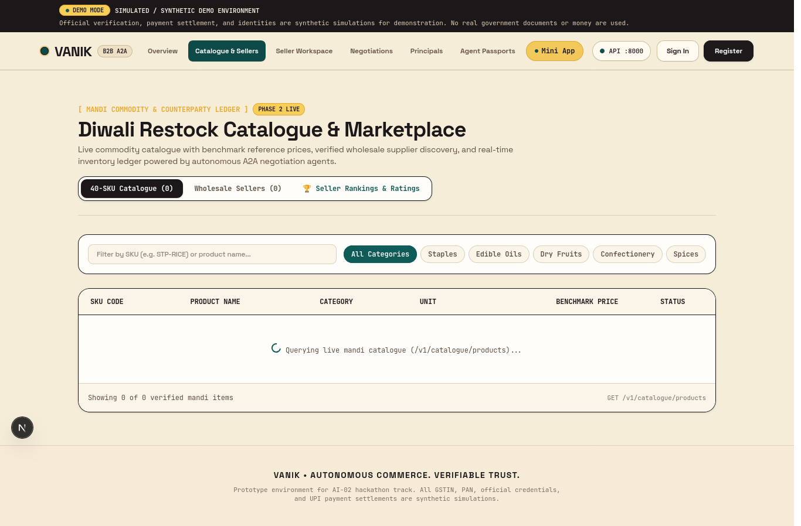

# VANIK

> Made as part of a 24-hour hackathon.

**Autonomous commerce. Verifiable trust.**

VANIK is an agentic B2B marketplace for wholesale trade. Verified businesses deploy persistent AI agents that discover suppliers, negotiate prices and credit terms concurrently, and prepare transactions for human cryptographic approval.

---

## Visual Tour

| Marketplace Portal | Parallel Multi-Agent Bargaining |
|---|---|
|  |  |

| Telegram Mini App Interface | 40-SKU Mandi Catalogue |
|---|---|
|  |  |

---

## Core Capabilities

- **Cryptographic Agent Passports:** Every agent receives an immutable Ed25519 keypair, public key fingerprint (`sha256:...`), and scoped delegation permissions.
- **Parallel Multi-Agent Bargaining:** A buyer agent broadcasts Requests for Quote (RFQs) and negotiates with multiple wholesale seller agents in parallel.
- **Strategic Seller Personas:** Sellers pursue independent commercial strategies (Margin Maximizer, Inventory Clearance, Payment-Risk Minimizer).
- **RFC-8785 A2A Protocol:** Agents communicate via canonical JSON envelopes signed with Ed25519 keys and protected by nonces against replay attacks.
- **Deterministic Guardrails:** The trust engine validates quotes against trusted Mandi benchmark prices to catch fake discounts. Free-text seller notes are quarantined to prevent prompt injection.
- **Human Approval & Settlement:** Human principals review line-item comparison matrices and sign approval challenges before simulated UPI, Mandi Escrow, or RTGS fund release.
- **Unified Interfaces:** Access the marketplace through the Next.js Web Dashboard, Telegram Bot (`@vanik33_bot`), or the interactive Telegram Mini App.

---

## System Architecture

```
Human Account ──► Business Principal ──► Agent Passport (Ed25519)
                                                │
Deal Settlement ◄── Human Approval ◄── A2A Parallel Rounds
```

For detailed specifications, see:
- [**Agent Architecture & A2A Protocol**](AGENT.md)
- [**Product Requirements Document (PRD)**](docs/PRD.md)
- [**System Architecture & Trust Model**](docs/ARCHITECTURE.md)
- [**API Reference**](docs/API.md)
- [**Data Model**](docs/DATA_MODEL.md)

---

## Monorepo Layout

```
VANIK/
├── apps/
│   ├── api/             # FastAPI backend service (port 8000)
│   ├── web/             # Next.js marketplace web app (port 3000)
│   └── telegram-bot/    # Telegram Bot worker and Mini App integration
├── packages/
│   └── shared-schemas/  # Shared Pydantic contracts and JSON Schemas
├── docs/                # Architecture, PRD, API, and Data Model specifications
│   └── assets/          # Application screenshots and diagrams
├── scripts/             # Orchestration and health inspection scripts
├── AGENT.md             # Autonomous agent protocol specification
└── Makefile             # Universal build and execution targets
```

---

## Quick Start

### Prerequisites

- Python 3.12+ and [`uv`](https://docs.astral.sh/uv/)
- Node.js 22+ and `npm`
- Docker or Podman (for PostgreSQL and Redis)

### 1. Installation

```bash
# Clone the repository
git clone git@github.com:yashwandhare/vanik.git
cd VANIK

# Install all backend, frontend, and bot dependencies
make install
```

### 2. Launch All Services

```bash
# Starts PostgreSQL, Redis, database migrations, seed data,
# FastAPI backend (port 8000), Next.js web portal (port 3000),
# and the Telegram bot worker in one command:
make run
```

### 3. Verify System Health

```bash
make health
```

### 4. Run Test Suites

```bash
# Run all tests across backend, bot, and frontend
make test

# Or run tests per component
make test-api
make test-bot
make test-web
```

### 5. Reset Demonstration State

```bash
# Resets the database and reseeds standard 40-SKU inventory and sellers
make reset-db
```

---

## Telegram Bot Interaction

VANIK includes a Telegram Bot (`@vanik33_bot`) with slash commands:

- `/start` — Business onboarding guide and deep link handler
- `/ganesh_kirana` — Quick-load Shree Ganesh Kirana Store persona
- `/ganesh_agent` — Spawn verified Kirana Buyer Agent with Ed25519 keys
- `/task` — Deploy 40-SKU procurement mandate across wholesale sellers
- `/miniapp` — Launch interactive Telegram Mini App
- `/auth_deal` — Cryptographically authorize winning deal and submit seller rating
- `/test` — Simulate adversarial seller attack and observe defenses
- `/disconnect` — Reset session state to rerun demonstration from scratch
